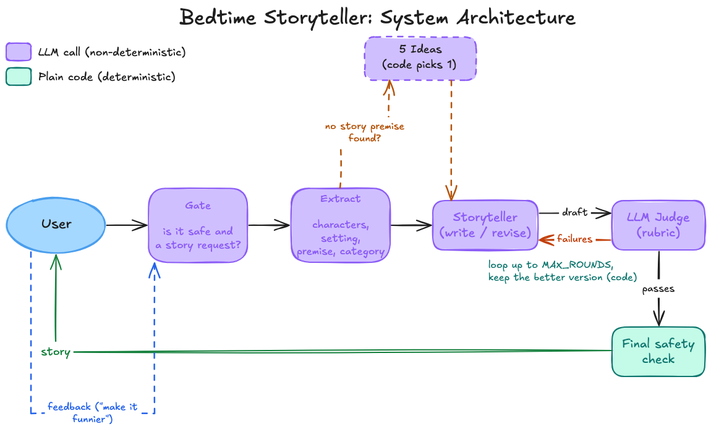

# Bedtime Story Teller

This is my submission for the Hippocratic AI take-home assessment: a bedtime story teller for children aged 5 to 10.

My take on this was to build a script that lets a user interact with the system directly. You start by asking for a story, then you get a chance to give feedback on it, and this can keep going till you're satisfied.

I also left in the ability to run the version that was provided to me, which I call the baseline version. This helped me compare how my system performs against a simple vanilla one.

## Running it

Requires Python 3.12.

```bash
python3.12 -m venv .venv
source .venv/bin/activate
pip install -r requirements.txt
cp .env.example .env        # then put your Anthropic API key in ANTHROPIC_API_KEY

python main.py "A story about a shy dragon who loves baking"
python main.py "..." --baseline    # the original single call, for comparison
pytest                             # tests run on a fake LLM, no API key needed
```

After the story, the script asks what to change. Type a change (for example `make it a little funnier`) and the same story is revised. Type `exit` or press Esc to quit.

## The system



I built the system around Haiku 5.5 with the aim of making this a reliable and safe bedtime story teller for children aged 5 to 10. On top of a single generation call, I added a few components:

1. Safety and relevance check
2. Pre-processing (extraction and categorization)
3. Generation (stacking-block prompting)
4. Judge and revision loop
5. Feedback (preferences and overrides)

In the diagram, I've separated the non-deterministic parts of the system from the deterministic ones: purple blocks are LLM calls, and teal blocks are plain code.

### 1. Safety and relevance check

Before a request reaches the rest of the system, it is checked for two things: is it actually a request for a bedtime story, and is it safe for children (no graphic violence, gore, etc.). If either check fails, the user gets a friendly message instead.

While designing this, I was reminded of a funny bug in Amazon's Rufus chatbot that let you ask it pretty much anything ([tweet](https://x.com/pseudotheos/status/2029957370323870040)). Our system doesn't suffer from the same problem.

### 2. Pre-processing

I run a small pre-processing block before I actually generate the story. Why am I doing this? I wanted to break down the user's intent into characters, setting and premise, because I felt I could use that to adjust how the prompt is generated. For the same reason, I also extract a category, so the prompting strategy fits the kind of story being asked for. I defined 4 categories based on my own intuition and research: adventure, silly, comfort and cozy.

### 3. Generation

Generation uses a stacking-block approach to prompting. Instead of one big prompt, the storyteller prompt is assembled from layers: a shared base block that is always present (audience 5 to 10, safety rules, a length target of about 600 words, and the bedtime wind-down where the last third slows down and ends sleepy), then a category block that swaps in the structure and do's and don'ts for that category, then one line per variable we actually extracted (characters, setting, premise, listener). Anything the user did not specify is left to the model's own judgment rather than forced. This keeps the constants in one place and lets each category change the story's shape without rewriting the whole prompt.

### 4. Judge and revision loop

Once a draft is written, an LLM judge grades it against a rubric. The rubric has hard checks (safety, bedtime wind-down, characters, consistency) and soft checks (language, story arc, engagement, premise, category, length). For each check, the judge says pass or fail, and how to fix it if it failed.

The failed checks go back to the storyteller as feedback, hard ones first, and it revises the story. The new draft is judged again, and a check in code keeps whichever version is better. This repeats up to 3 times, or until everything passes. If the final story still fails safety, the user gets a friendly message instead.

For a detailed look at this loop, I've drawn a diagram at [docs/diagrams/judge-loop.png](docs/diagrams/judge-loop.png).

### 5. Feedback

After a story is delivered, the user can ask for a change, and this keeps going until they're happy. Each change goes back through the safety check and pre-processing along with the original request, so the story's details stay up to date.

From the feedback I pull out two things:

* Preferences: how the story should be told ("make it funnier", "a bit shorter"). These are added to the storyteller's prompt.
* Overrides: asks that clash with a rubric check, like "end on a cliffhanger" against the bedtime wind-down. That check is switched off for this story, but safety can never be overridden.

The storyteller then revises the delivered story, and it goes through the same judge loop.

## Handling vague requests

A user could give us anything from no info at all ("tell me a bedtime story") all the way to a detailed prompt naming all the characters, setting and premise.

One challenge was vague requests with nothing named, where the system kept generating stories with the same recurring themes. To introduce variance, when there is no premise I ask the LLM for 5 different story ideas given whatever else we know, then pick one at random in code and write the story from it. Only the storyteller sees the picked idea, so the judge doesn't grade the story against something the user never asked for.

In my tests on 10 vague requests, this gave 10 distinct premises. Just telling the model to "be creative" did not work: it moved to a new favourite story instead, with "Lantern" in 9 of 10 titles. What spreads the output is asking for 5 ideas in one call, where the model can see all of them at once and is told to make them different.

## Baseline comparison

The baseline version is the original single-call script, running on the same model. Keeping it in the tool let me compare my system against a vanilla one request by request, rather than judging my own output in a vacuum.

## What I'd Build Next

* Per-user recent-history exclusion so repeat customers don't get repeated premises. A plain random pick over the model's generated options collides early, so excluding the last K picks is what actually guarantees no repeats for a returning user.
* An LLM "keep-better" comparison inside the revision loop, for when a revision passes the rubric but reads worse than the draft it replaced. Today a code guard only counts how many checks pass or fail, so it can't catch a revision that is technically compliant but duller.
* Judge calibration on stories with planted flaws alongside clean stories, to measure false passes and false fails. The whole loop trusts the judge's verdicts, so knowing its error rates in each direction is what tells me whether to trust the gate.
