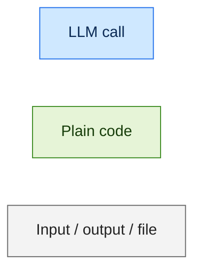
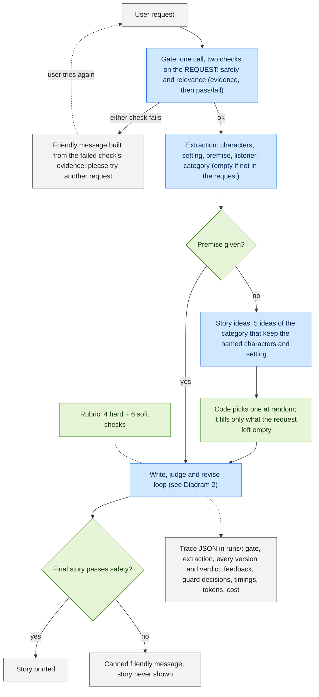
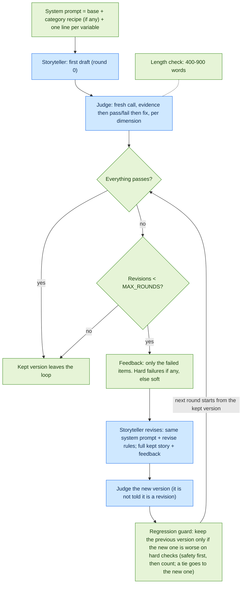

# Architecture (DRAFT for the author to refine)

> Status: the simplified first version. One draft per request, a rubric judge, and a code-only
> regression guard. Box names match the code in `storyteller/`. The fuller design (three
> drafts, premise brainstorm, LLM pairwise comparison, cross-draft selection, cozy fallback
> draft) is on branch `skeleton_extensive`; see "Deferred" in `OPEN_QUESTIONS.md`.

## Legend

Blue = an LLM call (every call uses the same model, Claude Haiku 5.5 via OpenRouter). Green = deterministic code. Grey = user-facing input/output or a file.

## Diagram 1: end to end

Three rules decide what the writer gets:

1. **Extract** characters, setting, premise and category. Anything not in the request stays empty; nothing is guessed.
2. **Category → recipe.** A category (adventure, silly, comfort, cozy) adds that category's prompt and its judge checks. No category means the base prompt alone. There is no default category.
3. **No premise → ideas.** One extra call (`storyteller/options.py`, prompt `prompts/options.md`) asks for 5 distinct ideas of the category that keep whatever the request named, and code picks one at random (`OPTIONS_SEED` makes the pick repeatable per request). The pick fills only the empty fields, and only the writer sees it: the judge checks faithfulness to what the parent asked for, never to the invented idea. The trace logs the full list and the pick. Why: when the writer invented its own plot, repeated vague requests converged on one template; see `docs/findings/independent_thinking_experiement.md`.

The gate and extraction are separate calls on purpose: a request that fails the gate stops before extraction is paid for. The gate returns two checks, `safety` and `relevance`, each with evidence written before `passed`; both must pass. The gate judges the *request*, not a story, and lets through requests that can be reshaped into something bedtime-appropriate.

## Diagram 2: the write, judge and revise loop

## Story variables

Extraction fills `characters`, `setting`, `premise`, `listener` and `category`. The **premise** is the content (what the story is about, in the request's words); the **category** is the recipe (how it is told). There is no separate mood or worry field: the category carries most of the tone (silly = funny, cozy = calm), any tone it doesn't cover is written into the premise ("a gently spooky night for an owl"), and a child's fear is the premise ("scared of the dark", category comfort). `listener` (who the story is for) is a line for the writer and is never treated as a character.

## Rubric

One structured judge call returns every LLM-judged dimension. Each verdict is written evidence first, then pass/fail, then a fix that says where in the story. There is no overall score. Failures are recomputed in code from each `passed` flag.

| Dimension | Hard / soft | Judged by | Skip rule |
|---|---|---|---|
| safety | hard | LLM | never skipped |
| wind_down | hard | LLM | never skipped |
| faithfulness_named | hard | LLM | skipped when the user named no characters and no setting |
| consistency | hard | LLM | never skipped |
| age_language | soft | LLM | never skipped |
| story_arc | soft | LLM | never skipped |
| engagement | soft | LLM | never skipped |
| faithfulness_premise | soft | LLM | skipped when no premise was given |
| category_checks | soft | LLM | uses the `## Judge checks` list of the category file |
| length | soft | code | word count outside 400-900 fails; no LLM call |

Skipped dimensions are told to the judge (evidence "N/A", passed true) and dropped again in code.

## Calls per run

| Case | LLM calls |
|---|---|
| Rejected by the gate | 1 |
| First draft passes everything | 4 (gate, extract, write, judge) |
| Worst case, MAX_ROUNDS = 3 | 10 (gate, extract, write, judge, then 3 × revise + judge) |

## Cost and latency guards

- One model for every call. No temperature (the model doesn't accept it). Hidden reasoning is turned off.
- `MAX_RUN_COST_USD` (default 0.10) is checked before and after each call. `BudgetExceeded` ends the run with a friendly message and a saved trace.
- Early stop: the loop ends as soon as the kept version passes everything. `MAX_ROUNDS` (default 3) caps revisions.
- Retries only on 429, 5xx, connection errors and schema-validation failures; other 4xx fail fast.
- `LATENCY_BUDGET_S` (default 60) is only recorded in the trace as `latency_budget_exceeded`; nothing acts on it.
- `python main.py --baseline` makes one plain call with just the request, the original `main.py` behaviour, for comparison.
