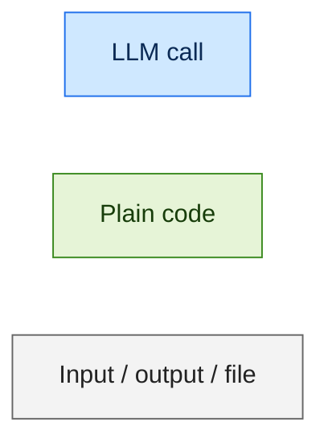
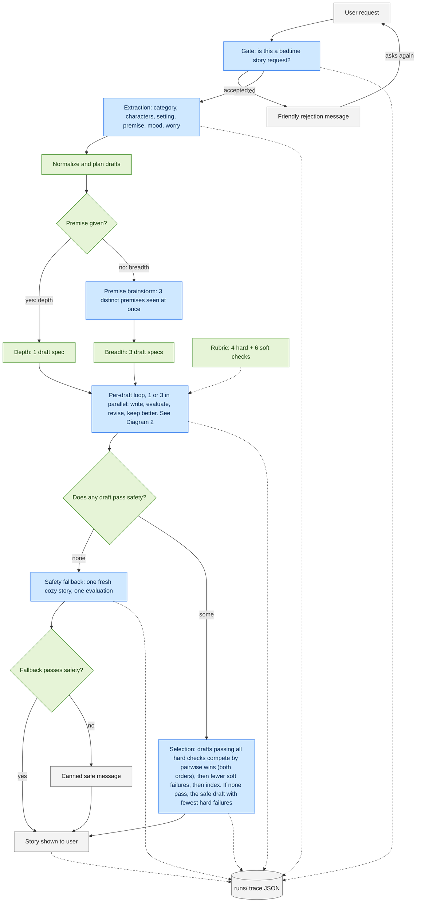
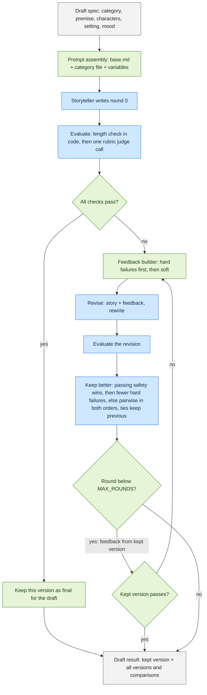

# Architecture (DRAFT for the author to refine)

> Status: first-pass diagrams written from the build handoffs, not hand-tuned. Names and boxes match the code in `storyteller/`.

## Legend

Blue = one or more LLM calls (all use the same model, Haiku 5.5 via OpenRouter). Green = deterministic code. Grey = user-facing input/output or a file.

## Diagram 1: end to end

Notes:
- If the budget guard trips (`BudgetExceeded`), `run` returns a friendly message with `status="error"` and still writes the trace. It is not drawn above to keep the picture readable.
- Dotted arrows into the trace mean "recorded"; the trace is written once in a `finally` at the end of `run`.

## Diagram 2: inside one draft

## Rubric

One structured judge call returns every LLM-judged dimension with evidence written before the verdict. Failures are recomputed in code from each `passed` flag.

| Dimension | Hard / soft | Judged by | Skip rule |
|---|---|---|---|
| safety | hard | LLM | never skipped |
| wind_down | hard | LLM | never skipped |
| faithfulness_named | hard | LLM | skipped when the user named no characters and no setting (settings the brainstorm invents don't count) |
| consistency | hard | LLM | never skipped |
| age_language | soft | LLM | never skipped |
| story_arc | soft | LLM | never skipped |
| engagement | soft | LLM | never skipped |
| faithfulness_premise_mood | soft | LLM | skipped when no premise and no mood |
| category_checks | soft | LLM | uses the `## Judge checks` list of the category file |
| length | soft | code | word count outside 400-900 fails; no LLM call |

Skipped dimensions are told to the judge (evidence "N/A", passed true) and dropped again in code.

## Cost and latency guards

- One model for every call; no temperature (the model does not accept it). Diversity comes from the brainstorm, not sampling.
- `MAX_RUN_COST_USD` (default 0.10) is checked before and after each call; `BudgetExceeded` ends the run with a friendly message and a saved trace.
- Drafts run in parallel (`asyncio.gather`); pairwise comparisons run both orders concurrently.
- Early stop: a draft stops revising as soon as its kept version passes everything. `MAX_ROUNDS` (default 3) caps revisions.
- Fewer hard failures decides without a comparison call.
- Retries only on 429, 5xx, connection errors and schema-validation failures; other 4xx fail fast.
- `LATENCY_BUDGET_S` (default 60) is only recorded in the trace as `latency_budget_exceeded`; nothing acts on it.
- Worst case with MAX_ROUNDS=3 in breadth is roughly 51 calls.
